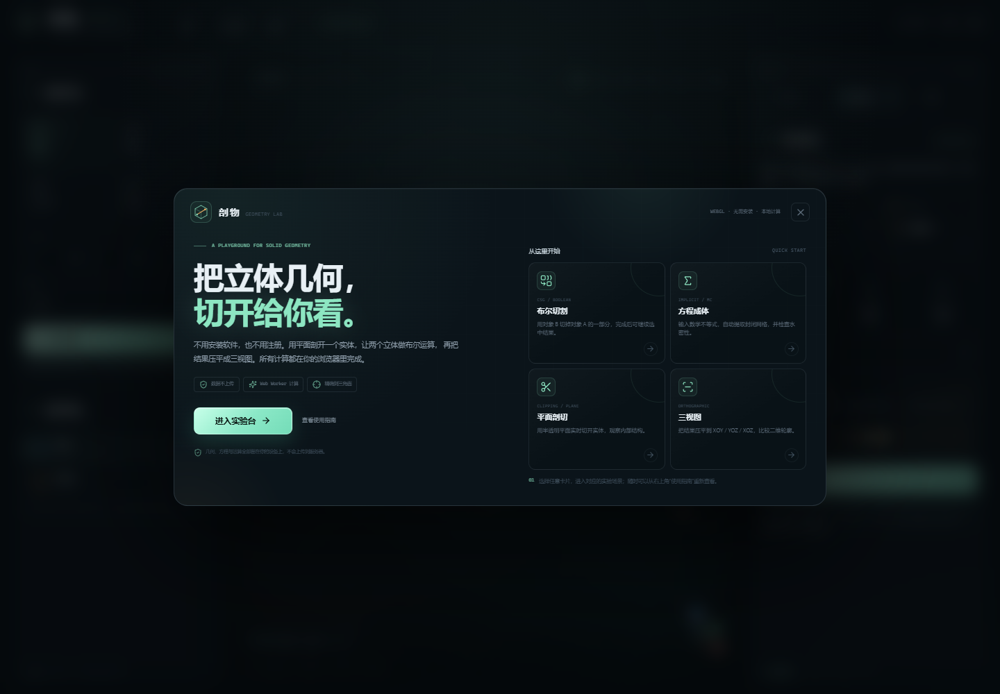
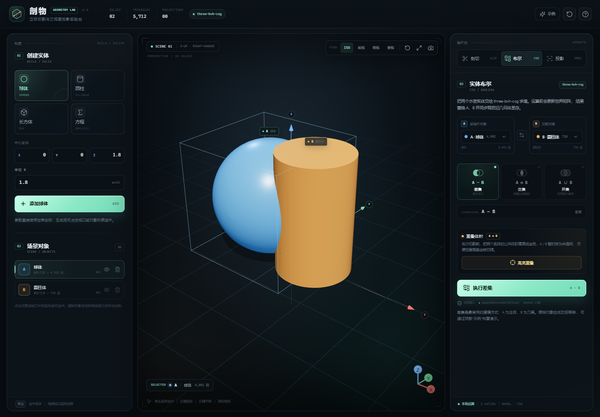
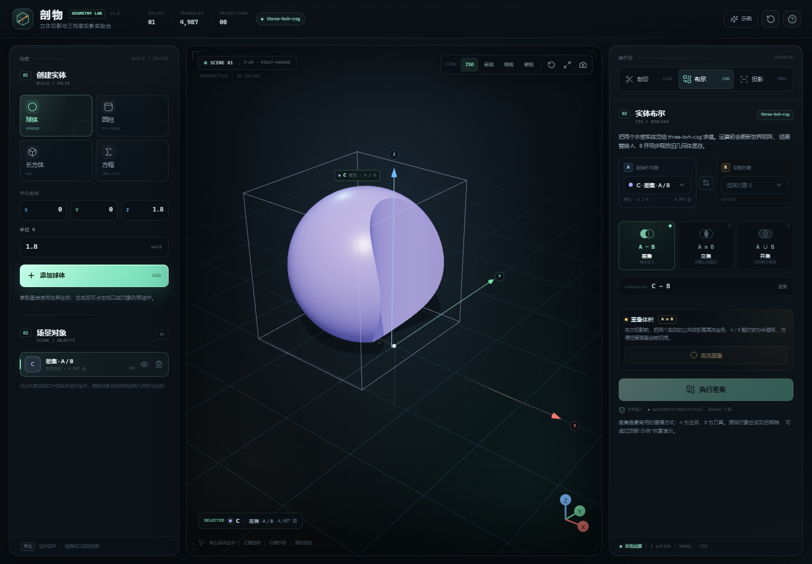
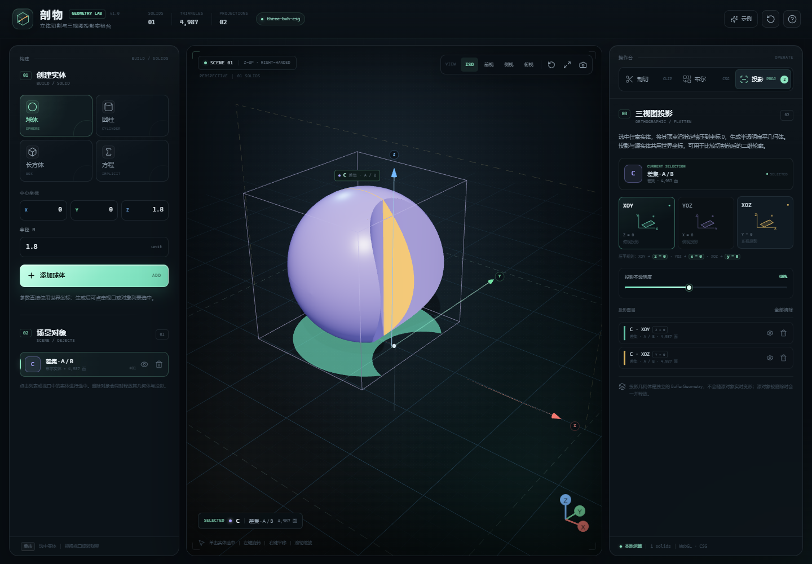
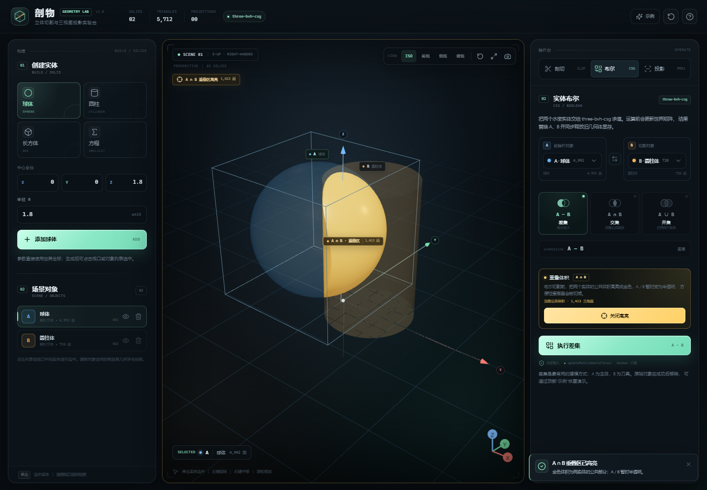
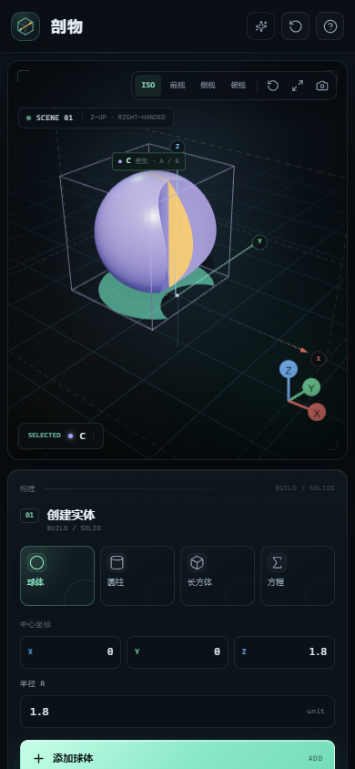

# 剖物 · Geometry Lab

纯 Web 端的 **3D 数学立体几何切割与投影可视化工具**。从基本解析立体到 Marching Cubes 隐式等值面，从平面裁剪到真正的 CSG 布尔实体，再到三视图投影，全部在浏览器本地完成，不依赖后端。

**目标发布地址：** https://lyc-000.github.io/geometry-lab/（GitHub Pages 自动部署工作流已就绪；推送 `main` 分支后生效）

> 首次访问会看到新手引导，可以选择一个引导示例直接开始；之后可以随时从右上角“使用指南”重新打开。

## 功能一览

| 模块 | 能力 |
| --- | --- |
| 3D 场景 | Z 轴朝上的右手系坐标空间、XOY 网格、带箭头坐标轴、OrbitControls 旋转/平移/缩放、ISO/前视/侧视/俯视/自动适配 |
| 解析实体 | 球体、圆柱体（可选 X/Y/Z 轴）、长方体；参数直接使用世界坐标 |
| 隐式实体 | LaTeX 实时预览 + Marching Cubes 等值面提取；支持方程与不等式；自动做边界检查、水密性检查、法线朝向校正 |
| 平面剖切 | Three.js ClippingPlanes 实时视觉裁剪；辅助平面、法向箭头、保留侧翻转；一键“固化”为真实半空间交集实体 |
| CSG 布尔 | 基于 **three-bvh-csg** 的 A−B / A∩B / A∪B；Web Worker 计算；世界矩阵显式更新；自动释放原几何体 |
| 重叠体积预览 | 布尔运算前可一键高亮 **A∩B 公共体积**；A / B 变为半透明“玻璃”，金色重叠区直观显示会被切掉/保留的部分 |
| 三视图投影 | 将选中实体的顶点分别压平到 XOY / YOZ / XOZ，使用半透明 MeshBasicMaterial 显示；支持图层开关、不透明度与删除 |
| 面向所有人 | 首次访问新手引导、四个一键体验示例、场景 PNG 快照、空状态提示、帮助指南、SEO / Open Graph / Web App Manifest |
| 交互与反馈 | 全局 Loading 遮罩、操作锁定、Radix Toast、错误提示、对象选择框、显存释放、响应式布局 |

### 操作结果截图

| CSG 差集 | 三视图投影 |
| --- | --- |
|  |  |

| 重叠体积预览 | 移动端 |
| --- | --- |
|  |  |

## 技术栈

- **React 19 + Vite 6 + TypeScript 5.8**
- **Three.js 0.180**（坐标空间、渲染、OrbitControls）
- **@react-three/fiber 9 + @react-three/drei 10**（声明式场景、Grid、Line、Html、Gizmo）
- **three-bvh-csg 0.0.18 + three-mesh-bvh 0.9**（核心 CSG 库）
- **math.js 15**（解析表达式、不等式、LaTeX 预览）
- **isosurface 1.0**（Marching Cubes）
- **KaTeX**（方程实时排版预览）
- **TailwindCSS 4 + Radix UI Primitives + lucide-react**

## 快速开始

要求 Node.js **20+**（推荐 22/24），支持 WebGL 2 的现代浏览器（Chrome / Edge / Firefox）。

~~~bash
npm install
npm run dev
# 打开 http://127.0.0.1:4317
~~~

生产构建与本地预览：

~~~bash
npm run build
npm run preview
# 打开 http://127.0.0.1:4318
~~~

> scripts/vite-runner.mjs 会在项目内 .tmp/ 下设置 esbuild/Vite 的临时目录，避免部分 Windows 沙箱拒绝子进程清理系统临时文件的问题；在普通机器上同样可用。

类型检查：

~~~bash
npm run typecheck
~~~

## 使用指南

### 1. 创建实体

初始场景内置示例：**球体 A** 与 **圆柱体 B**，二者相交，可直接体验差集。

- **解析实体**：选择球体 / 圆柱 / 长方体，填写中心坐标、半径或尺寸。
- **隐式实体**：输入一个方程或不等式，例如：

~~~text
x^2 + y^2 + z^2 <= 4
x^2/4 + y^2/2 + z^2/1.5 <= 1
abs(x) + abs(y) + abs(z) <= 2
x^2 + y^2 + z^2 = 4
~~~

“采样设置”里可以调整精度和采样范围。大于 16³ 的精度会明显增加三角面数。

### 2. 平面剖切

输入只包含 x、y、z 一次项的平面：

~~~text
x + y + z = 3.5
z = 2
2x - y + 3z = 4
~~~

- **视觉裁剪**：开启后实时裁去保留侧之外的部分，只影响 GPU 渲染，不改变几何数据。
- **固化剖切**：选择要处理的实体，点击“生成剖切实体”。程序会以大半个半空间盒与对象求交，生成真正封闭的新实体；原对象被替换。这样得到的结果才可以继续参与 CSG 和投影。

### 3. 实体布尔

1. 在“布尔”面板选择对象 A 与 B；
2. 选择 **A−B 差集**、**A∩B 交集** 或 **A∪B 并集**；
3. 点击执行。

A、B 会被交给 Web Worker 中的 three-bvh-csg。成功后，结果替换 A、B 并成为新的选中对象，原来的 BufferGeometry 会被 dispose()。原始对象可用顶部“示例”一键恢复。

**查看重叠体积：** 运算前点击“高亮重叠”，工具会先计算 A ∩ B，并把 A / B 变成半透明、公共体积显示为金色。这样你可以在真正执行差集前，直观看到 B 会从 A 中切掉哪一块。再点一次“关闭高亮”即可恢复实体材质。

> 如果视觉裁剪正在开启，布尔运算仍然基于完整几何体；需要剖切后的实体，请先在上一步“固化”。

### 4. 三视图投影

选中任意实体后，在“投影”面板选择：

- **XOY**：所有顶点 Z 坐标压到 0（俯视）
- **YOZ**：所有顶点 X 坐标压到 0（侧视）
- **XOZ**：所有顶点 Y 坐标压到 0（正视）

结果生成独立的扁平几何体，颜色按投影面区分，可用图层列表开关或删除，并可调整不透明度。

## 坐标约定

- 右手系，**Z 轴朝上**。
- X 轴向右（红），Y 轴向内（绿），Z 轴向上（蓝）。
- 网格位于 z = 0 的 XOY 平面。
- 所有对象几何体在生成时已烘焙（bake）到世界坐标，Mesh 本身保持单位变换，避免 CSG 与投影中的变换错位。

## 数学输入约定

- 变量：x、y、z；常量：pi、e。
- 比较符：=、<=、>=、<、>，也接受 Unicode 的 ≤、≥、π、² 等。
- 支持隐式乘法：2x 等价于 2*x。
- 函数：sqrt、abs、cbrt、sin、cos、tan、asin、acos、atan、atan2、sinh、cosh、tanh、exp、log、log10、log2、pow、min、max、floor、ceil、round、sign、hypot。
- 不允许赋值、数组、对象、条件表达式和未知符号/函数。

### 隐式等值面的封闭性策略

Marching Cubes 只在**场边界之外没有实体**时才可以得到封闭网格。生成器会：

1. 先在采样域六个面做符号采样，判断实体是否触碰到边界；
2. 对封闭方程，根据边界符号自动选择有界的一侧；
3. 提取等值面后合并重复顶点，检查**每条无向边恰好被两个三角面共享且方向相反**（非流形/破洞检测）；
4. 用有向体积判断整体法线方向，必要时翻转三角形朝向；
5. 计算平滑顶点法线后，输出带索引的 BufferGeometry。

因此像 x^2 + y^2 - z^2 = 1 这样的单叶双曲面、无界半空间、平面，以及触碰到采样边界的实体都会被拒绝，并显示 Toast / 表单错误，而不会把破面交给 CSG。

## 项目实施阶段

### 阶段一：基础框架与平面裁剪

- 搭建 Vite + React + TypeScript 工程、Tailwind 设计系统与 Radix UI 基础组件。
- 完成 Three.js / R3F 场景、Z 轴朝上坐标空间、OrbitControls、网格、坐标轴与相机预设。
- 完成球体、圆柱体、长方体参数化生成。
- 完成 math.js 解析、KaTeX 公式预览与隐式方程 Marching Cubes 实体生成（含水密检查）。
- 完成 ClippingPlanes 视觉平面裁剪、辅助平面与“固化剖切”。

关键文件：src/components/SceneCanvas.tsx、src/components/AddObjectPanel.tsx、src/components/ClipPanel.tsx、src/lib/implicit-core.ts、src/lib/relation.ts。

### 阶段二：three-bvh-csg 实体互切

- 接入 three-bvh-csg 的 Brush / Evaluator。
- 在 Web Worker 中执行差集、交集、并集，传输类型化数组，避免阻塞主线程。
- 运算前显式调用 updateMatrixWorld(true)；输入几何体保持世界坐标。
- 结果成为新对象，原 A/B 删除并 dispose()；全局 Loading 遮罩与失败 Toast。
- 完成 A/B 选择、运算类型选择、输入校验与空结果处理。

关键文件：src/lib/csg-core.ts、src/workers/csg.worker.ts、src/lib/csg-worker-client.ts、src/components/CsgPanel.tsx、src/store/useStudioStore.ts。

### 阶段三：三视图投影、面向所有人的体验与公开发布

- 顶点投影到 XOY/YOZ/XOZ，生成扁平 BufferGeometry 与半透明高亮材质。
- 投影图层列表、显示开关、不透明度、删除与源对象级联清理。
- **A∩B 重叠体积高亮预览**：布尔运算前透明化 A / B 并显示金色公共体积。
- 首次访问新手引导、四个一键体验示例（布尔切割 / 方程成体 / 平面剖切 / 三视图）。
- 场景 PNG 快照导出，带品牌水印与深色背景。
- 全局错误处理、Loading、Toast、帮助指南、对象列表、选中包围框、相机适配。
- SEO、Open Graph 社交卡片、Web App Manifest、图标、robots / sitemap 与 WebGL 错误兜底。
- 响应式布局（桌面三栏 / 中屏上下布局 / 移动端单栏），手机端触碰区域与 HUD 适配。
- 显存释放、演示场景恢复、空状态与可访问性细节。

关键文件：src/components/ProjectionPanel.tsx、src/components/WelcomeDialog.tsx、src/components/CsgPanel.tsx、src/lib/snapshot.ts、src/lib/geometry.ts、src/components/Viewport.tsx。

## 目录结构

~~~text
src/
├─ components/
│  ├─ SceneCanvas.tsx        3D 场景、光照、相机控制、裁剪/投影渲染
│  ├─ Viewport.tsx           视口容器、HUD、相机预设、空状态
│  ├─ AddObjectPanel.tsx     解析立体 + 隐式方程创建面板
│  ├─ ClipPanel.tsx          平面裁剪 / 固化
│  ├─ CsgPanel.tsx           布尔运算
│  ├─ ProjectionPanel.tsx    三视图投影
│  ├─ ObjectList.tsx         对象列表与删除/显示
│  ├─ WelcomeDialog.tsx      首次访问引导与快速示例
│  ├─ BrandMark.tsx          共用品牌图形
│  ├─ TopBar.tsx, RightPanel.tsx, LeftPanel.tsx, ui.tsx, ...
├─ hooks/useClipPlane.ts     平面解析 → THREE.Plane（含保留侧翻转）
├─ lib/
│  ├─ relation.ts            math.js 解析、线性平面校验、LaTeX
│  ├─ implicit-core.ts       边界检查 + Marching Cubes + 水密校验 + 法线
│  ├─ csg-core.ts            three-bvh-csg 求值 + 结果提取
│  ├─ geometry.ts            基元/投影/半空间/序列化
│  ├─ implicit-worker-client.ts / csg-worker-client.ts
│  ├─ onboarding.ts          首次访问状态
│  ├─ snapshot.ts            3D 场景 PNG 快照
│  ├─ colors.ts, utils.ts, demo.ts
├─ workers/                  implicit.worker.ts / csg.worker.ts
├─ store/useStudioStore.ts   Zustand 场景状态与显存清理
├─ styles/                   base / layout / panels / overlays / welcome
└─ types.ts

.github/workflows/deploy.yml  GitHub Pages 自动构建与部署
public/                        favicon、OG 图、manifest、robots、sitemap
~~~

## 质量与测试

已经在 Chrome（Playwright + SwiftShader WebGL）中实际验证以下流程：

- 初始场景渲染、OrbitControls 视角切换、相机自动适配；
- 对象选择（Canvas 点击 / 列表点击 / 空场景点击取消）；
- 球体、圆柱体、长方体创建与对象命名；
- CSG 差集、交集、空结果错误 Toast、原对象删除与结果配色；
- **A∩B 重叠体积高亮**：透明化 A / B、金色公共体积、HUD 与场景标签、关闭后场景恢复；
- 首次访问引导与四个快速开始流程（布尔 / 方程 / 剖切 / 三视图）；
- **场景 PNG 快照**：真实下载文件、文件名与图片内容可打开；
- 隐式椭球生成、水密性提示、单叶双曲面友好报错；
- 平面视觉裁剪、保留侧、辅助平面、固化剖切；
- 三视图投影（XOY/YOZ/XOZ）、不透明度、图层开关与删除；
- 全局 Loading 遮罩、错误 Toast、清空场景与恢复示例；
- 桌面 1440 / 1180 / 900，移动 390 宽度下无横向溢出；
- tsc --noEmit 通过；npm run build 生产构建通过；在 /geometry-lab/ 子路径下完成同样的引导、重叠预览、快照、CSG 与隐式实体流程；
- 资源加载失败数为 0，控制台无未处理错误。

## 公开发布

### GitHub Pages（自动部署已配置）

- 目标地址：https://lyc-000.github.io/geometry-lab/（需将代码推送到 GitHub 仓库后生效）
- 托管：GitHub Pages；构建产物为纯静态文件，无服务器、无用户数据上传。
- 自动部署：`.github/workflows/deploy.yml` 在 `main` 分支 push 后使用 Node 22 执行 `npm ci` 与 `npm run build`，并将 `dist/` 发布到 Pages。
- 子路径：工作流会注入 `VITE_BASE_PATH=/${repository-name}/`；`vite.config.ts` 读取该变量设置 Vite `base`。

### 本地复现 Pages 构建

~~~bash
# Windows PowerShell
$env:VITE_BASE_PATH='/geometry-lab/'
npm run build
npm run preview
# http://127.0.0.1:4318/geometry-lab/
~~~

### 换自定义域名 / 其它静态平台

1. 在 GitHub 仓库 Settings → Pages 中绑定自定义域名，随后把 index.html 内的 canonical / Open Graph URL 改为新域名；
2. 或直接把 `dist/` 部署到 Vercel / Netlify / Cloudflare Pages；这类平台默认从根路径 `/` 提供，不设置 `VITE_BASE_PATH` 即可；
3. OG 图、manifest、robots 与 sitemap 都已经在 `public/` 中随构建产物一起发布。

首次到访的用户会看到新手引导；若需重复体验引导，可在 URL 后添加 `?welcome=1`。

## 已知边界

- 隐式等值面基于固定分辨率网格，非常薄/小的特征需要更高精度和更紧凑的采样范围。
- 视觉剖切是 GPU 渲染层效果，不会自动生成剖面封盖；需要封盖实体请使用“固化剖切”。
- 投影沿用需求中的“压平全部顶点”方案，重叠三角面会在半透明叠加下产生深浅变化。
- CSG 的耗时和内存与三角面数相关；本工具已把运算放到 Worker，但超大网格仍受设备性能限制。
- 目前含 PNG 场景快照，但不含场景持久化、OBJ/STL 导出、撤销栈或多材质/UV 支持，可通过在现有几何管线之上扩展实现。

## 依赖与许可

各依赖遵循其原始许可：three (MIT)、three-bvh-csg (MIT)、three-mesh-bvh (MIT)、mathjs (Apache-2.0)、isosurface (MIT)、KaTeX (MIT)、React (MIT)、TailwindCSS (MIT)、Radix UI (MIT)。项目源码仅用于本地教学与可视化实验。
